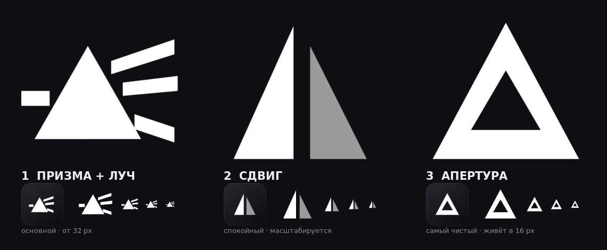

# Nexora Prism — три варианта знака

Черновики ребрендинга «Nexora Prism». **Ничего из этого ещё не подключено к
приложению**: `NexoraMark`, favicon, иконки Tauri и `public/logo.svg` не
тронуты. Здесь только варианты на выбор.



Каждый знак нарисован с чистой сетки 96×96: одна заливка (второй тон — тот же
белый с прозрачностью), без градиентов, bevel, свечения и без чёрной плашки
как части знака. Плашка вынесена в отдельный файл `*-plate.svg` и нужна только
для иконки приложения.

## Варианты

| # | Файл | Идея | Где живёт |
|---|---|---|---|
| 1 | `01-refract.svg` | призма + входящий луч и три выходящих | от 32 px; ниже — `01-refract-small.svg` |
| 2 | `02-displace.svg` | треугольник разрезан, половины сдвинуты | любой размер, самый устойчивый |
| 3 | `03-aperture.svg` | полый треугольник с апертурой | от 16 px, самый чистый |

Плашки: `01-refract-plate.svg`, `02-displace-plate.svg`,
`03-aperture-plate.svg`. Упрощённый вариант для favicon/трея:
`01-refract-small.svg`.

## Как менять геометрию

`generate.py` — исходники знаков (все координаты в одном месте),
`build.py` — рендер PNG и контактного листа. Нужен `@resvg/resvg-js`:

```
npm i -D @resvg/resvg-js
python3 generate.py && python3 build.py
```

## Права

Все три варианта нарисованы с нуля по идее «призма», а не по чужому шоту:
нет пирамиды с выступающей нижней вершиной, нет ребра на 50 % ширины, нет
bevel/bloom, нет плашки в составе знака. Идея не охраняется — охраняется
конкретная композиция. Даты коммитов в этой папке и есть доказательство
авторства, поэтому файлы лежат в репозитории, а не только локально.

Если появится желание использовать конкретный чужей знак как логотип —
сначала письменное разрешение автора (использование, изменение, коммерция,
регистрация товарного знака), иначе ни перерисовка в SVG, ни перевод в
монохром прав не дают.
