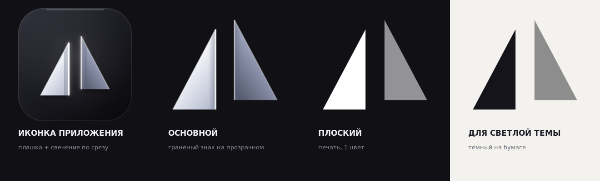

# Nexora Prism — знак «Сдвиг» (Displace)

Черновики ребрендинга «Nexora Prism». **Ничего пока не подключено к
приложению**: `NexoraMark`, favicon, иконки Tauri и `public/logo.svg` не
тронуты. Здесь только сам знак и его варианты.



## Идея

Один прямоугольный треугольник разрезан вертикально, половины разъехались на
`(+16, −8)` по линии среза. Это ровно то, что делает призма со светом: луч
меняет направление на границе среды. Призму рисовать не нужно — она читается
через само смещение.

Геометрия на сетке 96×96, габарит 4…92 по X и 10…86 по Y, центр ровно 48/48:

```
левый осколок   M40 18 L40 86 L4 86 Z
правый осколок  M56 10 L92 78 L56 78 Z
```

Обе половины равны по площади — поэтому это «один знак, сдвинутый по границе»,
а не две разные фигуры.

## Файлы

| Файл | Что это | Где применять |
|---|---|---|
| `02-displace-plate.svg` | знак на тёмной плашке: градиенты по граням, волосяной блик и мягкое свечение по срезам, тень под знаком | иконка приложения, стор-листинг, About |
| `02-displace.svg` | тот же знак без плашки, на прозрачном | сайт, презентации, крупные носители |
| `02-displace-flat.svg` | плоский: один цвет + один тон | печать, вышивка, гравировка |
| `02-displace-small.svg` | плотнее и без обработки | favicon, трей, 16–24 px |
| `02-displace-onlight.svg` | тёмная грань | светлая тема, бумага |
| `nexora-prism-displace-icon-1024.png` | рендер плашки 1024 px | быстрый просмотр, стор |

Другие направления, которые остались на выбор: `01-refract*` (призма + луч),
`03-aperture*` (полый треугольник), сводный лист `nexora-prism-sheet.png`.

## Как менять

`build-displace.py` — все координаты и градиенты в одном файле:

```
npm i -D @resvg/resvg-js
python3 build-displace.py
```

## Почему это не копия Lucent

В референсе подпись знака — объёмная пирамида с выступающей нижней вершиной,
ребро ровно на 50 % ширины, bevel и bloom вокруг фигуры, и всё это на плашке.
Здесь нет ни одного из этих элементов: силуэт из двух плоских осколков,
никакого центрального ребра и никакой пирамиды; «премиальность» сделана
светом по граням и по срезам, а не объёмной геометрией. Плашка — отдельный
слой, знак без неё самодостаточен.

Идея призмы не охраняется, охраняется конкретная композиция. Даты коммитов в
этой папке — доказательство авторства, поэтому файлы и лежат в репозитории.
